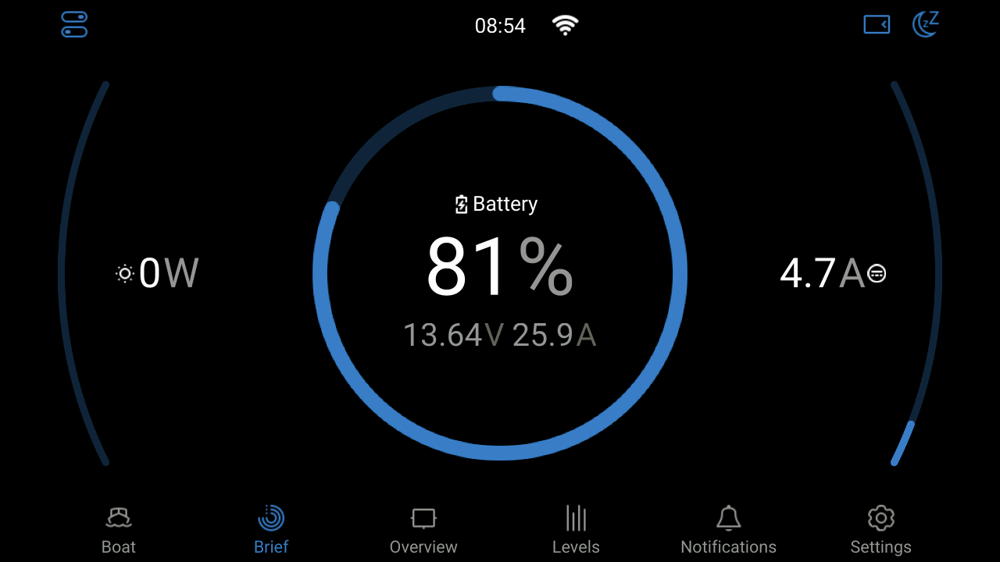
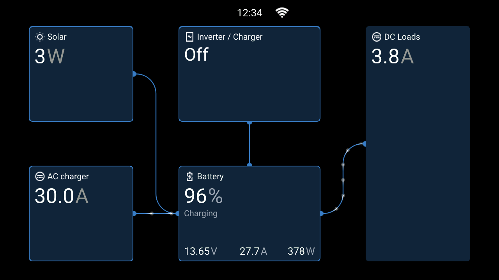

# venus-os-victron-ble

Read **SmartShunt**, **SmartSolar** and **Blue Smart charger** data over Bluetooth
on Venus OS, without VE.Direct cables.

Victron's Bluetooth products broadcast their main readings in encrypted
*Instant Readout* advertisements. Venus OS (v3.85) decodes these only for the
Lynx Smart BMS NG and the SolarSense. This adds a small service,
`dbus-victron-ble`, that decodes three more record types and publishes them
as regular Venus OS devices:

| Instant readout record | Products | Venus OS service |
|---|---|---|
| battery monitor | SmartShunt, BMV-712 Smart | `com.victronenergy.battery` |
| solar charger | SmartSolar MPPT, BlueSolar MPPT with VE.Direct Bluetooth Smart dongle | `com.victronenergy.solarcharger` |
| AC charger | Blue Smart IP22 / IP65 / IP67, Phoenix Smart IP43 | `com.victronenergy.charger` |

The devices then show up like wired ones: in the GUI (device list, overview,
battery and charger pages), on VRM (logging, dashboard, remote console), over
MQTT and in Node-RED. The data is **read only**, and the devices take no part
in DVCC. One optional exception: the **night mode of a Blue Smart charger** can
be switched from Venus OS, see [Night mode switch](#night-mode-switch-blue-smart-chargers).



*gui-v2 with all three devices connected over Bluetooth: solar power from the
SmartSolar, battery from the SmartShunt, and DC loads computed with the IP22
charger's output.*

**Status:** version 0.3.0, tested in one installation: a Raspberry Pi 4 with
Venus OS v3.85 (large), a SmartShunt, a SmartSolar MPPT and a Blue Smart IP22
charger. Technical background: [docs/design.md](docs/design.md).

## How it works

- **Passive.** Venus OS' own `dbus-ble-sensors` keeps the Bluetooth controller
  scanning (for RuuviTags, tank sensors...). The kernel hands a copy of every
  advertising report to each raw HCI socket, so `dbus-victron-ble` just listens
  along. It sends no HCI commands, so `dbus-ble-sensors` and its sensors
  keep working exactly as before. There is one exception: when nothing at all
  has been received for two minutes, for example because Bluetooth sensors
  are disabled, it switches scanning on.
- **No pairing, no connection.** Advertisements are broadcast; the devices stay
  free for VictronConnect on phones. (The optional night mode switch is the
  exception: it connects briefly and needs the charger's PIN.)
- The records are decrypted with each device's key (AES-128-CTR) and decoded
  according to Victron's
  [Extra manufacturer data](https://communityarchive.victronenergy.com/storage/attachments/extra-manufacturer-data-2022-12-14.pdf)
  specification.
- **Only devices with a key are published.** Other people's devices nearby
  (a marina is full of them) are ignored.
- A device is published as `com.victronenergy.<type>.victron_<mac>`. Its key,
  name and VRM instance are stored where `dbus-ble-sensors` keeps the settings
  of the Victron devices it supports:
  `/Settings/Devices/victron_<mac>/{Key,CustomName,ClassAndVrmInstance}`.
  Should a future Venus OS support these devices natively, they carry over,
  and `dbus-victron-ble` steps aside for any device that `dbus-ble-sensors`
  publishes itself.
- A device disappears from D-Bus after 5 minutes without data, and comes
  back when it is heard again.
- An AC charger advertises only while it is on its mains, and its last
  records are sent while it powers down (an IP22: still "Bulk", 0.2 A at
  19.2 V). After 15 s without data it is therefore shown as Off with 0 A and
  an unknown voltage until it is heard again or disappears.
- Everything lives in `/data`, with a hook in `/data/rcS.local`. Firmware
  updates do not remove it.

It needs only what every Venus OS image has: Python 3 with dbus-python and
PyGObject, OpenSSL's libcrypto and Bluetooth. It should therefore also run on
GX devices with Bluetooth. Root access via SSH is needed to install it.

## Install

Download `venus-os-victron-ble-0.3.0.tar.gz` from the
[latest release](https://github.com/MiSaren/venus-os-victron-ble/releases/latest),
copy it to the Venus device and run the installer:

```sh
scp venus-os-victron-ble-0.3.0.tar.gz root@venus.local:/tmp/
ssh root@venus.local
cd /tmp && tar -xzf venus-os-victron-ble-0.3.0.tar.gz && victron-ble/install.sh
```

The installer copies everything to `/data/victron-ble`, adds the boot hook
to `/data/rcS.local` and starts the service. Running it again updates an
installation.

To build the package yourself from a clone of this repository, run
`tools/dist.sh`. It writes the package to `dist/`.

## Add your devices

1. In **VictronConnect**, open the device, its settings (gear icon) and
   **Product info** from the ⋮ menu. Set **Instant readout via Bluetooth** to
   *Enabled*. Under **Instant readout details**, tap **Show** to see the
   device's MAC address and encryption key. The option appears with recent
   firmware; update the device in VictronConnect if it is missing.
2. On the Venus device:

   ```sh
   /data/victron-ble/victron-ble key C0:FF:EE:12:34:56 0123456789abcdef0123456789abcdef
   ```

   The service picks the key up within a second and the device appears in the
   GUI with its next advertisement.
3. Optionally give it a name: `victron-ble name C0:FF:EE:12:34:56 "House bank"`,
   or rename it in the GUI on its device page.

`victron-ble` without arguments shows what the service hears and publishes:

```
dbus-victron-ble 0.3.0, up 5 s, Bluetooth: hci0, advertisements: 95 (Victron 95)

ADDRESS            PRODUCT                            TYPE              RSSI  HEARD  KEY  STATE
C0:FF:EE:00:00:01  SmartShunt 500A/50mV               battery monitor    -60     0s  yes  ok
                -> com.victronenergy.battery.victron_c0ffee000001 (instance 20) "Domestic": 13.20 V, -4.25 A, 79.6 %, starter 12.62 V
C0:FF:EE:00:00:02  SmartSolar Charger MPPT 75/15      solar charger      -61     0s  yes  ok
                -> com.victronenergy.solarcharger.victron_c0ffee000002 (instance 20): 104 W, 13.40 V, 7.5 A, today 0.44 kWh, bulk
C0:FF:EE:00:00:04  SmartShunt 1000A/50mV              battery monitor    -63     0s  no   no key
```

`victron-ble scan [seconds]` listens directly and lists the Victron devices in
range, with or without a key, which helps to find MAC addresses. Devices whose
Instant readout is still disabled are listed as *instant readout off*.
`victron-ble forget <MAC>` removes a key. `victron-ble dcsource <MAC> on`
also shows an AC charger with its power on the overview page (see below).

Changing a device's Bluetooth PIN code in VictronConnect also changes its
encryption key. The device then shows as *wrong key* until you store the new
key.

## What is published

Every device has `/ProductId`, `/ProductName`, `/CustomName` (writable),
`/DeviceInstance`, `/Connected`, `/Mgmt/Connection` = `Bluetooth LE` and
`/Mgmt/InsecureConnection` = 1. As for `dbus-ble-sensors`' devices, the
last one tells systemcalc not to use a Bluetooth battery voltage for shared
voltage sense.

| Service | Paths |
|---|---|
| battery | `/Dc/0/Voltage`, `/Dc/0/Current`, `/Dc/0/Power` (V × I), `/Soc`, `/ConsumedAmphours`, `/TimeToGo`; depending on the aux input `/Dc/1/Voltage` (starter battery), `/Dc/0/MidVoltage` and `/Dc/0/MidVoltageDeviation`, or `/Dc/0/Temperature`; from the alarm reason `/Alarms/LowVoltage`, `HighVoltage`, `LowSoc`, `LowStarterVoltage`, `HighStarterVoltage`, `LowTemperature`, `HighTemperature`, `MidVoltage` (0 ok, 2 alarm) |
| solarcharger | `/State`, `/ErrorCode`, `/Dc/0/Voltage`, `/Dc/0/Current`, `/Yield/Power`, `/Load/I`, `/Yield/User`; daily history `/History/Overall/DaysAvailable`, `/History/Daily/0..30/{Yield,MaxPower,MinBatteryVoltage,MaxBatteryVoltage,MaxBatteryCurrent,TimeInBulk,TimeInAbsorption,TimeInFloat,LastError1..4}` (`MaxPvVoltage` is not in the readout) |
| charger | `/State`, `/ErrorCode`, `/Dc/0..2/Voltage`, `/Dc/0..2/Current`, `/NrOfOutputs`, `/Dc/0/Temperature`, `/Ac/In/L1/I` |
| dcsource (optional, for AC chargers) | `/Settings/MonitorMode` = -2 (AC charger), `/Dc/0/Voltage`, `/Dc/0/Current` and `/Dc/0/Power` (all outputs together), `/Dc/0/Temperature` |
| switch (optional, chargers with a PIN) | `/State` = 256 (connected), `/SwitchableOutput/night/State` (writable: 1 night mode, 0 normal), `/SwitchableOutput/night/Status` (0 off, 9 on, 8 fault), `/SwitchableOutput/night/Name` = *Night mode*, `/SwitchableOutput/night/Settings/{CustomName,Group,ShowUIControl}` (writable, kept in the settings), `/SwitchableOutput/night/Settings/Type` = 1 (toggle) |

A SmartShunt becomes the system battery monitor when it is the only one
(Settings > System setup > Battery monitor: Automatic).

**Solar yield on VRM:** VRM computes the solar energy from increases of
`/Yield/User`, the total yield, but the advertisement only carries today's yield.
`dbus-victron-ble` therefore keeps its own total. It adds every increase of
today's yield and starts over when the charger begins a new day. The total
is kept in `/data/victron-ble/state.json`. Energy produced while the charger
is not heard at the end of a day is missed.

**Solar history:** a solar charger on VE.Direct publishes 31 days of history
from its own memory; the advertisement has none. `dbus-victron-ble` records it
instead, so the solar charger's *History* page in gui-v2 (and VRM) has a table
and a chart, as in VictronConnect. Days are calendar days in the local time
of the Venus time zone setting, day 0 is today. The yield of a day is the sum
of the increases of the charger's daily yield; the other values are the
extremes and the time in each charge state seen while the charger was heard.
History starts when the service is installed; days on which the GX was off
stay empty. It is kept in `/data/victron-ble/state.json`.

**AC chargers in the gui-v2 overview:** gui-v2 shows an AC charger in its
*Inverter / Charger* widget. The widget's text is the system state, which
Venus OS derives only from inverters and inverter/chargers. Without a Multi or
Quattro it reads *Off*, even while the charger is charging. Wired chargers
behave the same way. Tap the widget to open the charger's own page. The
charging current shows in the battery current, and the DC loads are computed
from it.

To see the charger with its power in the overview's left column, turn on
`victron-ble dcsource <MAC> on`. The charger is then also published as a DC
source of the type *AC charger* (`com.victronenergy.dcsource.victron_<mac>`),
just like a SmartShunt in DC energy meter mode. gui-v2 draws an *AC charger*
box for such a source.

- systemcalc leaves DC sources out of the DC loads, and the DC source has no
  energy counter. Nothing is counted twice.
- VRM lists the charger twice, as a charger and as a DC meter.
- The *Inverter / Charger* widget stays.
- The box appears about 10 seconds after the charger. The DC source gets its
  name with a delay, so that gui-v2 recognises it as an AC charger (see
  [docs/design.md](docs/design.md)).

`victron-ble dcsource <MAC> off` removes it again. The idea comes from
[ChargerMeter](https://github.com/mebitek/ChargerMeter), which does the same
for a wired IP22.



Not in the advertisements, so not available: PV voltage, history beyond
today, firmware version, serial number, relay state and settings.

## Night mode switch (Blue Smart chargers)

Optionally, `dbus-victron-ble` switches the **night mode** of a Blue Smart
charger, as VictronConnect does: the charger then limits its current to 50 %
and stops its fan for 8 hours, or until night mode is switched off. Unlike
everything else here, this needs a Bluetooth connection, and so the charger's
Bluetooth PIN:

```sh
/data/victron-ble/victron-ble control C0:FF:EE:12:34:56 on    # asks for the PIN
```

The PIN can also come from stdin (`echo 123456 | victron-ble control ...`), but
never from the command line. Within a minute the service reads the charger,
and a **Night mode** switch appears in the gui-v2 switch pane, under the
charger's name. It is a regular Venus OS switch,
`com.victronenergy.switch.victron_<mac>`, so Node-RED and other D-Bus or MQTT
clients can use it too: `/SwitchableOutput/night/State`, 1 = night mode,
0 = normal. From the command line: `victron-ble night <MAC> on|off`, or without
a state to show it.

- **What it writes:** one register of the charger, 0xE001 (charge current
  mode), 0 = normal and 2 = night. The charger lowers its maximum current
  itself. The code refuses to send any other write.
- **Where the register comes from:** Victron does not document this protocol.
  The register was found by reading all registers of a Blue Smart IP22 12/30
  (firmware 3.69) with night mode off, on and off again, then confirmed by
  writing it and checking the result in VictronConnect. Other Blue Smart
  models probably use the same register. If a charger does not have it, no
  switch is published, and the log says so.
- **Short connections:** a session takes 5 to 10 seconds: when the switch is
  used, and every 15 minutes to read the state. Night mode also changes with
  VictronConnect or the MODE button, and it ends by itself after 8 hours.
  During a session VictronConnect cannot connect to the charger. The other way
  round, while VictronConnect is connected, a switch attempt fails. The switch
  then shows a fault until the next successful read.
- **Pairing:** the charger only talks to paired devices. The service pairs by
  itself with the stored PIN, also after every reboot, because Venus OS does
  not keep Bluetooth pairings. The PIN is in `/data/victron-ble/pins.json`,
  readable by root only. It is not stored in the Venus settings, because
  anyone on the LAN can read those through MQTT. After changing the charger's
  PIN, run `victron-ble control <MAC> on` again.
- **Instant readout keeps working:** while connecting, the kernel changes the
  Bluetooth scan, and the service then restores `dbus-ble-sensors`' scan
  settings ([docs/design.md](docs/design.md)).
- **No on/off:** the IP22 has no register for switching the charger off, and
  VictronConnect has no such switch for it either.
- `victron-ble control <MAC> off` removes the PIN and the pairing, and the
  switch disappears.
- `--control-poll SECONDS` changes the read interval, and `--no-control`
  turns the feature off completely (options of `dbus-victron-ble.py`).

## Range and update rate

- By default `dbus-ble-sensors` scans about one sixth of the time, which is
  enough for devices with a good signal. **Continuous scanning**
  (*Continuous scanning* in the Bluetooth sensors settings, setting
  `/Settings/BleSensors/ContinuousScan`) listens all the time and catches
  about five times as many advertisements.
- In the installation this was tested in, the SmartShunt's signal was weak,
  so continuous scanning was enabled. The service then works fine with
  occasional pauses between updates.
- Bluetooth range suffers from metal, water, batteries and bulkheads. On a
  Raspberry Pi the antenna is internal and the radio is shared with WLAN. A
  USB Bluetooth adapter with an external antenna helps; the service listens on
  all adapters automatically.
- RSSI values below about -85 dBm mean the device is at the edge of the range.
- Devices in a VE.Smart network alternate Instant readout advertisements with
  VE.Smart networking packets. The latter are encrypted with the network's key
  and cannot be read; they are ignored.
- CPU load on a Raspberry Pi 4 (600 MHz, the Venus default): about 0.1 % of one
  core with the default scanning and about 1.6 % with continuous scanning
  (about 30 advertisements per second around).

## Troubleshooting

- `/data/victron-ble/victron-ble` shows the state of each device:
  *no key*, *wrong key*, *ok*, *no data* (gone for 5 minutes),
  *not supported* (another record type). For a charger with night mode
  control, a *night mode:* line shows the state, the time of the last read,
  and the last error, such as *pairing failed: wrong PIN?* or *charger not
  reachable (busy with VictronConnect, or out of range?)*.
- Log: `tail -F /var/log/dbus-victron-ble/current | tai64nlocal`
- Service: `svstat /service/dbus-victron-ble`, restart with `svc -t /service/dbus-victron-ble`
- Do not store a key for a device that is also connected by cable
  (VE.Direct, VE.Can). It would be counted twice.
- With *Modification checks* set to disallow modifications, Venus OS renames
  `/data/rcS.local` to `rcS.local.disabled`, and the service no longer starts at boot.

## Uninstall

```sh
/data/victron-ble/uninstall.sh            # stop, remove the boot hook
/data/victron-ble/uninstall.sh --purge    # ... and delete /data/victron-ble
```

The keys, names and VRM instances remain in the Venus OS settings.

## Development

```
dbus-victron-ble.py     the service
victron-ble             command line tool
victronble/records.py   record decoders (bit layouts of the specification)
victronble/hci.py       passive HCI listener, scan commands
victronble/manager.py   devices, keys, D-Bus services
victronble/history.py   daily history of solar chargers
victronble/control.py   night mode switch: helper sessions, switch service
victronble/vesmart.py   VE.Smart (GATT) protocol, the Bluetooth session helper
victronble/cbor.py      minimal CBOR for VE.Smart
victronble/pins.py      the root-only PIN file
victronble/settings.py  localsettings access
victronble/products.py  product names (generated by tools/gen_products.py)
ext/velib_python/       Victron's vedbus.py (MIT)
tests/                  unit tests, integration test, advertisement generator
tools/                  dist.sh (release tarball), gen_products.py (product names)
install.sh, boot.sh, uninstall.sh   install on Venus OS, boot hook, removal
docs/design.md          design notes (docs/img: screenshots)
```

- Unit tests (on a development machine; Venus OS' Python has no `unittest`):
  `python3 -m unittest discover -s tests`. They include real advertisements
  of a SmartShunt, a BlueSolar MPPT and a Blue Smart IP22 with their keys.
- `tests/integration_test.py` runs the service on a private D-Bus with
  synthetic, encrypted advertisements (`--replay`) and checks the published
  services, names, instances, keys added at runtime, the yield counter,
  the timeout and the night mode switch (with `tests/fake_vesmart.py`
  standing in for the Bluetooth session). By default it uses a small localsettings stand-in, which makes
  it safe on a live Venus device. With `--localsettings path/to/localsettings.py`
  it uses the real localsettings, but only do that on a development machine:
  a second localsettings instance on a Venus device checks the password file
  at startup and may change it.
- `tests/advgen.py` builds encrypted advertisements for tests and demos.
- `tools/dist.sh` builds the release tarball; `tools/gen_products.py`
  regenerates `victronble/products.py`.
- Code style: black and flake8 with a line length of 110.

## Why not ...

- **... extend `dbus-ble-sensors`?** That would be the natural place, but it is
  built on Victron's `velib` C library, which is not public. It cannot be built
  outside Victron.
- **... use a BlueZ/bleak based driver?** Those start their own scans through
  BlueZ, which interferes with the raw HCI scanning of `dbus-ble-sensors`
  (RuuviTags and tank sensors stop updating). Libraries installed with pip
  also vanish with every firmware update. The night mode switch does use
  BlueZ (through D-Bus, no extra packages), but only for short connections
  without scanning, and it restores the scan afterwards.

## Credits and license

- Victron Energy: the *Extra manufacturer data* specification and `velib_python`
  (MIT).
- [keshavdv/victron-ble](https://github.com/keshavdv/victron-ble) (public
  domain): real advertisements with keys used as test vectors, and the
  product name table.
- VE.Smart protocol: the server side in Venus OS' own `vesmart-server`, and
  community notes by [kkrankall/victron-ble-gatt](https://github.com/kkrankall/victron-ble-gatt)
  and [Prinsessen/victron-ble-openhab](https://github.com/Prinsessen/victron-ble-openhab).

MIT license, see [LICENSE](LICENSE).

This is an independent community project. It is not made, endorsed or
supported by Victron Energy. Victron, Venus OS, SmartShunt, SmartSolar and Blue
Smart are names of Victron Energy products. Use it at your own risk.
